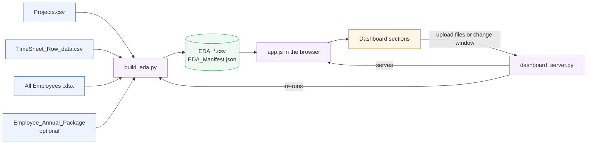
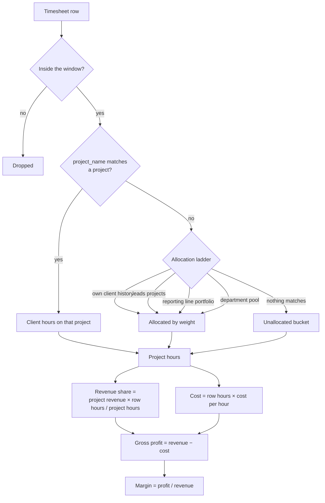
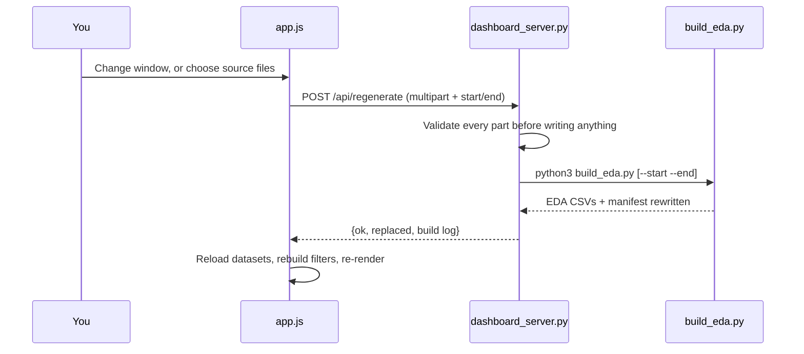

# Project Profitability Dashboard

Local, offline-friendly dashboard that turns raw timesheets and project contracts into revenue, delivered hours, cost and margin per client, project, team lead and person. Everything runs on your machine: a Python standard-library build script writes a set of EDA CSVs, and a static page reads them in the browser. No database, no install, no data leaves the folder.

---

## 1. Run it locally

**Prerequisites**

- Python 3.9 or newer (standard library only, nothing to `pip install`)
- A modern browser
- Internet access on first page load, only for the PapaParse CSV parser and Google Fonts pulled from a CDN. To go fully offline, save `https://cdn.jsdelivr.net/npm/papaparse@5.4.1/papaparse.min.js` next to `index.html` and point the last `<script src="...">` in `index.html` at the local copy.

**Start**

```bash
cd /Users/nishchal.gupta/Downloads/Dashboard_Profit_by_project
python3 build_eda.py          # optional first pass; the server can also rebuild on demand
python3 dashboard_server.py   # serves the folder on port 8765
```

Then open <http://localhost:8765/index.html>. Stop the server with `Ctrl+C`. To use a different port, change `PORT` in `dashboard_server.py`.

**Do not double-click `index.html`.** Opening it as `file://` makes the browser block the CSV fetches and the page shows *"Failed to fetch. Run python3 dashboard_server.py..."*. The server is what makes the data readable, and it is also what handles file uploads and rebuilds.

**Build a specific window from the command line**

```bash
python3 build_eda.py --start 2026-08-01 --end 2026-08-15
```

Both flags are optional and take ISO dates. With no flags the window is the full span of dates found in the timesheet.

**Re-check the outputs after any build**

```bash
python3 validate_eda.py
```

It re-derives every accounting identity the dashboard depends on and exits non-zero if one breaks.

---

## 2. What is in the folder

| File | Role |
| --- | --- |
| `Projects.csv` | Source. Contract amount, client, service, team lead, start/end/deadline, status. |
| `TimeSheet_Row_data.csv` | Source. One row per logged time entry: person, date, hours, status, day type, project or general task. |
| `All Employees - Finanshels.com.xlsx` | Source. Employee master: email, reporting line, department, job title. |
| `Employee_Annual_Package.csv` / `.xlsx` | Optional source. Person plus annual package. Absent by default, which is why cost and margin start locked. |
| `build_eda.py` | The whole calculation: parsing, matching, allocation, revenue recognition, data-quality counters. |
| `dashboard_server.py` | Static file server plus `POST /api/regenerate`, which accepts replacement source files and re-runs the build. |
| `index.html`, `styles.css`, `app.js` | The dashboard. `app.js` reads the EDA CSVs and does the live slicing, revenue attribution and costing. |
| `validate_eda.py` | Post-build assertions over the generated CSVs. |
| `EDA_Client_Summary.csv` | Generated. One row per client: hours split, revenue, top project/team lead/service, project concentration. Backs the Client summary page's company baseline. |
| `EDA_People_Summary.csv` | Generated. One row per person: clients and projects touched, top client and its share, biggest project, revenue share. Backs the People summary page's company medians. |
| `EDA_*.csv`, `EDA_Manifest.json` | Generated. Deleting them is safe; rebuild recreates them. |

---

## 3. Using the dashboard

- **Window** (top right) sets the reporting period. Changing it re-runs `build_eda.py` server-side, because the window changes hours, revenue recognition and the allocation history together. "Full history" returns to every dated timesheet row.
- **Filters** scope every section at once. "Hours basis" switches between all logged hours and approved-only. "Department allocation" is explained under [Allocation](#allocation).
- **Overview** shows revenue, hours, cost, profit, margin for the current filter set, plus hours by allocation method.
- **Revenue & margin drill-down** descends Client → Project → Team lead → Submitted by. Click any row to go a level deeper, use the breadcrumb to come back.
- **Delivery hours** descends Team lead → Person → Client → Project.
- **Allocation audit** shows every donor project that set the weight for someone's internal time.
- **Internal time** shows non-client hours by category, person, reporting line or department, and can push a slice down onto the clients and projects that absorbed it.
- **People** shows utilisation, allocation coverage and cost per person. Click a person for their own team/client/project breakdown.
- **Client summary** and **People summary** are pages of their own, grouped under "Summaries" at the foot of the rail and marked in indigo rather than the report's olive. Opening one replaces the scrolling report; the window and filter bar stay live, so a filter set carries across. They are also linkable directly as `index.html#clients` and `index.html#people-summary`.
  - **Client summary** clusters every client on revenue and delivered hours, shows the blended hourly cost with the estimated portion called out, and descends Client → Project → Team lead → People. Clustering and the blended rate are defined under [Client clustering](#client-clustering) and [Blended hourly cost](#blended-hourly-cost).
  - **People summary** shows who each person delivers for, the project taking most of their hours, and the rules that flag their mix. See [Insight rules](#insight-rules).
- **Sources** replaces any source file and rebuilds. Uploading `Employee_Annual_Package.csv` or `.xlsx` is what unlocks cost, profit and margin; until then those cells show a dash.
- Every table has an **Export** button that writes the current view as CSV.

---

## 4. Definitions

### Hours

**Parsing.** A timesheet `hours` value is read either as a decimal (`7.5`) or as `HH:MM:SS` (`07:30:00` → 7.5).

**Display.** Every hours figure on screen is shown as a duration (`17h 3m`, `45m`, `2h`) rather than a decimal. Exports keep the raw decimal so downstream arithmetic is unchanged.

**Client vs internal.** A row is *client* time when its `project_name`, normalised (lowercased, spaces/dots/dashes/underscores stripped), matches a project name in `Projects.csv`. Everything else is *internal* time: meetings, training, idle, admin, and any row naming a project the projects file does not contain.

**Window.** With an explicit `--start`/`--end`, only rows dated inside the window survive; rows with an unparseable date are dropped. With no window, the period is the min and max timesheet date and every dated row is kept.

**Approved.** `approved_hours` counts rows whose status is exactly `approved`; everything else is `nonapproved_hours`. Both are always reported, and the "Hours basis" filter chooses which one drives the on-screen totals.

**Non-working.** Rows whose `day_type` is not `working_day` (leave, holiday) are counted in `nonworking_hours` and still included in total hours, because they are a real payroll cost.

**Identities that always hold** (enforced by `validate_eda.py`):

```
logged hours   = client hours + internal hours
internal hours = allocated hours + unallocated hours
emitted hours  = logged hours          (nothing is created or lost by allocation)
row total      = actual + allocated + unallocated
row total      = approved + non-approved
```

### Allocation

Internal time is real cost, so leaving it in a pool makes every project look more profitable than it is. Allocation spreads each person's internal hours onto client projects using a *portfolio* of donor projects, i.e. where client hours were actually booked in this window.

For a person with internal hours `H` and a donor portfolio `{p: donor_hours(p)}`:

```
allocated_hours(p) = H × donor_hours(p) / Σ donor_hours
```

The portfolio is chosen by the first rung that has any hours, most specific first:

| Rung | Method name | Donor portfolio |
| --- | --- | --- |
| 1 | Employee Weighted Allocation | The person's own client hours in this window. |
| 2 | TL Self Portfolio Allocation | The person leads projects, so the projects they lead. |
| 3 | AM Weighted Allocation | The portfolio of the projects their reporting line leads. |
| 4 | Department Weighted Allocation | The client hours booked by their whole department. |
| — | Unallocated | No rung produced any hours. The time is parked in the "Unallocated internal time" bucket with a reason: not in the employee master, no department on the record, or the department books no client hours. |

Every weight is written to `EDA_Allocation_Audit.csv` with `weight_pct`, which sums to exactly 100% per person and method.

**Department allocation toggle.** Rung 4 is the weakest link: a person's time lands on projects they never touched, purely because their department did. The toggle in the filter bar turns it off in the browser, returning those hours to the Unallocated bucket instead. Total company hours are unchanged either way. In the current build that moves 379.08h of unallocated time to 1,855.58h.

### Revenue recognition

**Contract revenue** is the sum of `amount` across *every* row in `Projects.csv` sharing a project name. Duplicate rows are summed, not first-wins, and the recovered amount is reported as a data-quality counter.

**In-window revenue** is effort-based:

```
overlap_days = days shared by [project start, project end] and [window start, window end]
span_days    = project end - project start + 1

if the project window overlaps the reporting window:
    in-window revenue = contract revenue × overlap_days / span_days      # basis: Prorated
else:
    in-window revenue = contract revenue                                  # basis: Undated full / Out-of-window full
```

The full-recognition branch is deliberate: hours were logged against that project inside the window, so the work demonstrably happened even though the contract dates do not say so. Those projects are all listed in the "Projects with revenue period mismatch" register so the assumption stays visible and auditable.

**Revenue attribution to rows.** Revenue lives once per project. A row's share is its share of that project's hours, and the denominator is every row of the project, not just the rows a filter leaves on screen:

```
row revenue = project in-window revenue × row hours / all hours of that project
```

Unfiltered, every grouping — by client, project, team lead, person, service, status — totals to the same revenue figure. Filtered, the view carries the revenue attributable to the hours it still shows, so revenue, revenue per hour and margin all move with the filter set.

> **Project-level filters keep full revenue.** Client, status, frequency and revenue type are project attributes, so filtering on them keeps or drops whole projects and their revenue with them. Row-level filters — person, service, allocation method, hours basis, search — cut into a project, and revenue scales down with the hours removed.

### Cost, profit and margin

Cost needs the annual package file. A person is matched by email first, then by normalised full name.

```
absorption (default)
    window cost  = annual package × window days / 365
    cost / hour  = window cost / that person's total logged hours

standard rate
    cost / hour  = annual package / annual hours       (default 2080, editable in the Overview)

row cost     = row hours × cost / hour
gross profit = in-window revenue − cost
margin %     = gross profit / in-window revenue × 100
cost coverage % = hours belonging to people who have a rate / hours in view

delivered hours  = actual hours + allocated hours          (unallocated excluded)
revenue / hour   = in-window revenue / delivered hours
cost / hour      = cost / all logged hours in view
```

The two rates use different denominators on purpose. Unallocated hours earn nothing, so leaving them in the revenue rate would dilute it and would hide the effect of the department-allocation toggle, which moves hours between the allocated and unallocated buckets without changing the total. Cost is incurred on every logged hour, unallocated included, so it stays over all hours.

Absorption charges the whole payroll for the window and spreads it over whatever was actually logged, so people who logged less carry a higher rate per hour. The standard rate ignores how much was logged and is the better comparison when timesheet discipline is uneven. Watch cost coverage: with only part of the roster costed, margin is optimistic.

### Blended hourly cost

The package file rarely covers everyone, and hours belonging to an uncovered person are priced at zero, which quietly flatters margin. The Client summary page exposes a blended AED/hour that fills in **only** those people:

```
cost / hour for a person =
    flat cost-per-hour override, if the filter bar sets one       (applies to everyone)
    else their own package rate, absorption or standard           (as above)
    else the blended rate, if one is set                          (estimated)
    else 0                                                        (uncosted)

rate from packages      = cost of packaged hours / packaged hours
effective blended rate  = total cost in view / total hours in view
estimated share %       = hours priced at the blended rate / hours in view × 100
```

Three figures rather than one, because they answer different questions: what the real packages imply, what rate is actually being applied, and how much of that is a guess. The panel splits the hours in view into priced-from-packages, priced-at-the-blended-rate and not-costed, and the Overview's cost and margin cards restate the estimated share whenever it is above zero. Leaving the rate blank reproduces the old behaviour exactly: uncovered hours stay at zero cost and nothing is marked estimated.

### Client clustering

The Client summary page groups clients by k-means on two features, in the browser, over whatever the filters currently leave on screen:

```
feature vector = [ log1p(in-window revenue), log1p(delivered hours) ]  then z-scored
```

`log1p` comes first because both quantities are heavily right-skewed. Without it a handful of anchor clients define every centroid on their own and the remaining clusters are noise around zero. The z-score comes second so AED figures do not swamp the hours axis purely for being numerically larger.

Seeding is k-means++ driven by a fixed-seed PRNG, so the same filter set always yields the same clusters — cluster membership that reshuffles on every re-render cannot be reasoned about. Lloyd iterations are capped at 50 and stop early once no point changes cluster.

k is chosen by sweeping k = 2 to min(8, clients − 1) and keeping the highest **simplified silhouette**, which scores each point on its distance to its own centroid against its distance to the nearest rival centroid:

```
silhouette(point) = (nearest rival centroid distance − own centroid distance)
                    / max(own, nearest rival)
```

The textbook silhouette compares each point against every other point, which is O(n²); at over a thousand clients, recomputed for each candidate k on every filter change, that is too slow to sit behind a filter box. The centroid form is O(n·k) and selects the same k in practice. The chosen k and its score sit in the note under the cluster cards. Results are cached against the filter set, and fewer than four clients in view falls back to a single group with a note.

Cluster names come from each cluster's own position, not its rank: a cluster is **Anchor** when its median revenue is at least five times the median across all clients in view, **Core** at or above that median, **Long tail** below it, and **No revenue booked** when its median revenue is zero. The suffix compares the cluster's revenue per delivered hour against the overall rate — high yield at 1.25× or more, low yield at 0.8× or less, par yield between. Naming by rank alone would call a zero-revenue cluster "mid-market" purely for placing third.

The `Unallocated / Overhead` pseudo-client is excluded from the clustering, since it is absorbed internal time rather than a client, and is tagged `overhead` in the table.

### Insight rules

The People summary page flags people by deterministic rules rather than a model, so every card can be checked against the table underneath. Each card shows the rule, how many people match, and the aggregate behind it; clicking one keeps only the people it flags. The thresholds live in one block at the top of the section in `app.js`:

| Rule | Condition |
| --- | --- |
| Single-client dependency | Top client takes ≥ 70% of their hours, on ≥ 20h logged |
| Spread too thin | ≥ 12 projects at under 2h median each |
| Low utilisation | Under 50% client time, on ≥ 20h logged |
| Unallocated hours | Any internal time no portfolio could absorb |
| Cost above yield | Cost per logged hour exceeds revenue per delivered hour (only shown once cost is available) |
| Non-approved backlog | More than 25% of their logged hours never reached approved |
| Missing from master | Logging time but absent from the employee master |
| Missing cost | No annual package on file |

The last two are informational rather than risks, so the "flagged as a risk" tally excludes them — with no package file loaded, "missing cost" matches the whole roster and would make the count meaningless.

Utilisation on this page is recomputed from the rows in view, so it tracks the filters like every other figure, while the company medians in the stat strip come from `EDA_People_Summary.csv` and stay fixed as the filters move. Approval state is read from the underlying rows, so the non-approved backlog stays visible even when the hours basis is set to approved-only.

### Utilisation

```
utilisation %      = client hours / total logged hours × 100
internal %         = internal hours / total logged hours × 100
allocated out      = internal hours − unallocated hours
```

---

## 5. Flow

**Build and serve**



**How one timesheet row becomes profit**



**Rebuild loop from the browser**



---

## 6. Validation status

Last full pass, on the 2026-07-22 → 2026-09-04 window (45 days, 23,337.33h logged, 10,658 emitted rows, AED 2,727,675 in-window revenue):

| Check | Result |
| --- | --- |
| `python3 -m py_compile build_eda.py dashboard_server.py`, `node --check app.js` | clean |
| Full build | 23,337.33h logged = 11,188.07h client + 12,149.25h internal; reconciliation drift −0.000146h, the rounding floor of six-decimal output |
| `validate_eda.py`, 32 accounting identities | all pass, including the client and people summaries reconciling to emitted hours, logged hours and in-window revenue |
| Browser logic (revenue conservation across 7 grouping dimensions, department toggle, hours basis, each filter, internal spread, both cost modes) | all pass; every grouping totals to the same AED 2,727,675 |
| Headless render of `index.html` against the running server | all sections populate, no load error |
| Client and people summary pages, 38 browser assertions | all pass; client revenue equals the Overview, both drills descend and return, clusters are deterministic across a cold cache, the blended rate unlocks cost at hours × rate and clearing it restores the locked state exactly |
| Upload guards: wrong extension, unknown field, empty file, malformed date, reversed window, partial write | all rejected correctly, no source file touched on rejection |
| Cost path with a package file, both `.csv` and `.xlsx` | column detection, email and name matching, and both cost modes correct; stale package file of the other extension removed on upload |

Two fixes came out of this pass:

- `dashboard_server.py` now validates every uploaded part before writing any of them. Previously a multi-file upload whose second file was invalid had already overwritten the first.
- `build_eda.py` dropped an unused audit accumulator that was labelled `internal_hours` but held the allocated share, which would have misled anyone extending the audit output.
