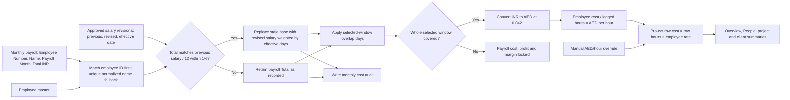
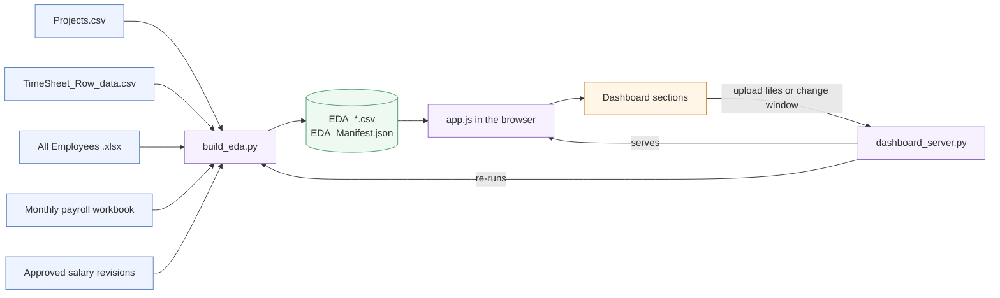
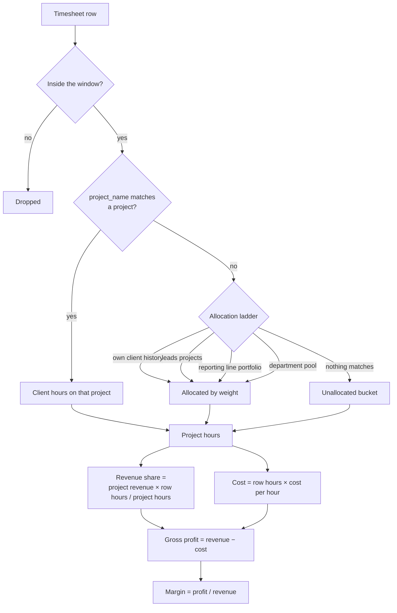
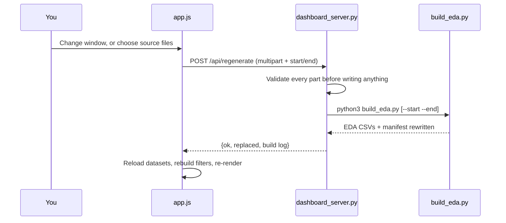

# Project Profitability Dashboard

Local, offline-friendly dashboard that turns raw timesheets and project contracts into revenue, delivered hours, cost and margin per client, project, team lead and person. Everything runs on your machine: a Python standard-library build script writes a set of EDA CSVs, and a static page reads them in the browser. No database, no install, no data leaves the folder.

---

## 1. Run it locally

**Prerequisites**

- Python 3.9 or newer (standard library only, nothing to `pip install`)
- A modern browser
- Internet access on first page load, only for the PapaParse CSV parser and Google Fonts pulled from a CDN. To go fully offline, save `https://cdn.jsdelivr.net/npm/papaparse@5.4.1/papaparse.min.js` next to `index.html` and point the last `<script src="...">` in `index.html` at the local copy.

**Start**

```bash
cd /Users/nishchal.gupta/Downloads/Dashboard_Profit_by_project
python3 build_eda.py          # optional first pass; the server can also rebuild on demand
python3 dashboard_server.py   # serves the folder on port 8765
```

Then open <http://localhost:8765/index.html>. Stop the server with `Ctrl+C`. To use a different port, change `PORT` in `dashboard_server.py`.

**Do not double-click `index.html`.** Opening it as `file://` makes the browser block the CSV fetches and the page shows *"Failed to fetch. Run python3 dashboard_server.py..."*. The server is what makes the data readable, and it is also what handles file uploads and rebuilds.

**Build a specific window from the command line**

```bash
python3 build_eda.py --start 2026-08-01 --end 2026-08-15
```

Both flags are optional and take ISO dates. With no flags the window is the full span of dates found in the timesheet.

**Re-check the outputs after any build**

```bash
python3 validate_eda.py
```

It re-derives every accounting identity the dashboard depends on and exits non-zero if one breaks.

---

## 2. What is in the folder

| File | Role |
| --- | --- |
| `Projects.csv` | Source. Contract amount, client, service, team lead, start/end/deadline, status. |
| `TimeSheet_Row_data.csv` | Source. One row per logged time entry: person, date, hours, status, day type, project or general task. |
| `All Employees - Finanshels.com.xlsx` | Source. Employee master: employee number, name, email, reporting line, department, job title. Payroll and revisions join to it by employee number. |
| `All Employees Month-on-Month YTD Report_Jan 2026 - Aug 2026 _.xlsx` | Source. Monthly payroll; `Employee Number`, `Payroll Month` and `Total` drive employee cost. `Total` is reported in INR. |
| `Emp_Salary_Revisions_Finanshels.com_.xlsx` | Source. Approved regular-salary revisions keyed by employee number, with effective dates. Corrects payroll months only when `Total` still matches the previous salary base. |
| `build_eda.py` | The whole calculation: parsing, matching, allocation, revenue recognition, data-quality counters. |
| `dashboard_server.py` | Static file server plus `POST /api/regenerate`, which accepts replacement source files and re-runs the build. |
| `index.html`, `styles.css`, `app.js` | The dashboard. `app.js` reads the EDA CSVs and does the live slicing, revenue attribution and costing. |
| `validate_eda.py` | Post-build assertions over the generated CSVs. |
| `EDA_Client_Summary.csv` | Generated. One row per client: hours split, revenue, top project/team lead/service, project concentration. Backs the Client summary page's company baseline. |
| `EDA_People_Summary.csv` | Generated. One row per person: clients and projects touched, top client and its share, biggest project, revenue share. Backs the People summary page's company medians. |
| `EDA_Payroll_Cost_Monthly.csv` | Generated audit. One row per payroll employee-month, showing source `Total`, revision basis, calculated monthly cost, and whether an effective-dated correction was applied. |
| `Cost_Allocation_Flow.drawio` | Editable draw.io diagram of matching, salary-revision handling, date coverage, currency conversion, and row allocation. |
| `EDA_*.csv`, `EDA_Manifest.json` | Generated. Deleting them is safe; rebuild recreates them. |

---

## 3. Using the dashboard

- **Window** (top right) sets the reporting period. Changing it re-runs `build_eda.py` server-side, because the window changes hours, revenue recognition and the allocation history together. "Full history" returns to every dated timesheet row.
- **Filters** scope every section at once. "Hours basis" switches between all logged hours and approved-only. "Department allocation" is explained under [Allocation](#allocation).
- **Overview** shows revenue, hours and payroll-based cost for the current filter set, plus hours by allocation method. Profit and margin are available only when the entire selected date window is covered by payroll.
- **Revenue & margin drill-down** descends Client → Project → Team lead → Submitted by. Click any row to go a level deeper, use the breadcrumb to come back.
- **Delivery hours** descends Team lead → Person → Client → Project.
- **Allocation audit** shows every donor project that set the weight for someone's internal time.
- **Internal time** shows non-client hours by category, person, reporting line or department, and can push a slice down onto the clients and projects that absorbed it.
- **People** shows utilisation, allocation coverage and payroll cost per person, plus approved salary revisions and effective dates. Click a person for their own team/client/project breakdown.
- **Client summary** and **People summary** are pages of their own, grouped under "Summaries" at the foot of the rail and marked in indigo rather than the report's olive. Opening one replaces the scrolling report; the window and filter bar stay live, so a filter set carries across. They are also linkable directly as `index.html#clients` and `index.html#people-summary`.
  - **Client summary** clusters every client on revenue and delivered hours, shows payroll coverage and descends Client → Project → Team lead → People. Clustering is defined under [Client clustering](#client-clustering).
  - **People summary** shows who each person delivers for, the project taking most of their hours, and the rules that flag their mix. See [Insight rules](#insight-rules).
  - **Monthly Comparisons** (`index.html#trends`) charts projects active, people logging time, hours (client vs internal) and recognised revenue month on month or week on week (Monday-start weeks), plus revenue vs payroll cost and gross margin. It reads `EDA_Trends.csv`, which always covers the full timesheet history, so the window and dimension filters do not apply; the FX rate and manual cost / hour do. Partial periods are faded and left out of the headline change. Monthly revenue is the full-history recognised revenue split by period (dated contracts by calendar days, undated ones by hours logged), so the months sum to the Overview figure.
- **Sources** replaces any source file and rebuilds. The payroll workbook powers cost; salary revisions are shown for audit. Replace both through Sources when payroll data is refreshed.
- Every table has an **Export** button that writes the current view as CSV.

---

## 4. Definitions

### Hours

**Parsing.** A timesheet `hours` value is read either as a decimal (`7.5`) or as `HH:MM:SS` (`07:30:00` → 7.5).

**Display.** Every hours figure on screen is shown as a duration (`17h 3m`, `45m`, `2h`) rather than a decimal. Exports keep the raw decimal so downstream arithmetic is unchanged.

**Client vs internal.** A row is *client* time when its `project_name`, normalised (lowercased, spaces/dots/dashes/underscores stripped), matches a project name in `Projects.csv`. Everything else is *internal* time: meetings, training, idle, admin, and any row naming a project the projects file does not contain.

**Window.** With an explicit `--start`/`--end`, only rows dated inside the window survive; rows with an unparseable date are dropped. With no window, the period is the min and max timesheet date and every dated row is kept.

**Approved.** `approved_hours` counts rows whose status is exactly `approved`; everything else is `nonapproved_hours`. Both are always reported, and the "Hours basis" filter chooses which one drives the on-screen totals.

**Non-working.** Rows whose `day_type` is not `working_day` (leave, holiday) are counted in `nonworking_hours` and still included in total hours, because they are a real payroll cost.

**Identities that always hold** (enforced by `validate_eda.py`):

```
logged hours   = client hours + internal hours
internal hours = allocated hours + unallocated hours
emitted hours  = logged hours          (nothing is created or lost by allocation)
row total      = actual + allocated + unallocated
row total      = approved + non-approved
```

### Allocation

Internal time is real cost, so leaving it in a pool makes every project look more profitable than it is. Allocation spreads each person's internal hours onto client projects using a *portfolio* of donor projects, i.e. where client hours were actually booked in this window.

For a person with internal hours `H` and a donor portfolio `{p: donor_hours(p)}`:

```
allocated_hours(p) = H × donor_hours(p) / Σ donor_hours
```

The portfolio is chosen by the first rung that has any hours, most specific first:

| Rung | Method name | Donor portfolio |
| --- | --- | --- |
| 1 | Employee Weighted Allocation | The person's own client hours in this window. |
| 2 | TL Self Portfolio Allocation | The person leads projects, so the projects they lead. |
| 3 | AM Weighted Allocation | The portfolio of the projects their reporting line leads. |
| 4 | Department Weighted Allocation | The client hours booked by their whole department. |
| — | Unallocated | No rung produced any hours. The time is parked in the "Unallocated internal time" bucket with a reason: not in the employee master, no department on the record, or the department books no client hours. |

Every weight is written to `EDA_Allocation_Audit.csv` with `weight_pct`, which sums to exactly 100% per person and method.

**Department allocation toggle.** Rung 4 is the weakest link: a person's time lands on projects they never touched, purely because their department did. The toggle in the filter bar turns it off in the browser, returning those hours to the Unallocated bucket instead. Total company hours are unchanged either way. In the current build that moves 379.08h of unallocated time to 1,855.58h.

### Revenue recognition

**Contract revenue** is the sum of `amount` across *every* row in `Projects.csv` sharing a project name. Duplicate rows are summed, not first-wins, and the recovered amount is reported as a data-quality counter.

**In-window revenue** is effort-based:

```
overlap_days = days shared by [project start, project end] and [window start, window end]
span_days    = project end - project start + 1

if the project window overlaps the reporting window:
    in-window revenue = contract revenue × overlap_days / span_days      # basis: Prorated
else:
    in-window revenue = contract revenue                                  # basis: Undated full / Out-of-window full
```

The full-recognition branch is deliberate: hours were logged against that project inside the window, so the work demonstrably happened even though the contract dates do not say so. Those projects are all listed in the "Projects with revenue period mismatch" register so the assumption stays visible and auditable.

**Revenue attribution to rows.** Revenue lives once per project. A row's share is its share of that project's hours. The denominator is every project row, except when an allocation method is selected, when it is the hours for that method:

```
row revenue = project in-window revenue × row hours / eligible project hours
eligible project hours = all project hours, or selected-method hours when filtered by method
```

Unfiltered, every grouping — by client, project, team lead, person, service, status — totals to the same revenue figure. Selecting an allocation method keeps the full revenue for each represented project; hours and cost change with the selected method, so profit and margin reflect that method's delivery cost. Other row-level filters, such as person, service or search, continue to carry only the revenue attributable to the hours they show.

> **Project-level filters keep full revenue.** Client, status, frequency and revenue type are project attributes, so filtering on them keeps or drops whole projects and their revenue with them. Allocation method is also revenue-preserving for represented projects. Person, service and search filters cut into a project, and revenue scales down with the hours removed.

### Cost, profit and margin

Payroll rows first join to the employee master by `Employee Number`; the existing timesheet-to-master match supplies that ID. If no ID match is available, the build falls back to a normalized employee name only when it identifies one payroll employee. Ambiguous names remain unmatched and payroll-only IDs are listed in the manifest.

```
revised month cost (INR)   = Σ((annual regular salary / 12) × days at that salary / days in month)
monthly cost (INR)         = revised month cost only when Total matches previous salary / 12 within 1%
                            (minimum INR 2); otherwise retain payroll Total
payroll cost (AED)         = selected-window cost (INR) × active INR → AED filter rate
                            (default 0.042 AED per INR from the EDA manifest)
cost / hour                = window payroll cost (AED) / that person's total logged hours

row cost     = row hours × cost / hour
gross profit = in-window revenue − cost
margin %     = gross profit / in-window revenue × 100
cost coverage % = hours belonging to people who have a rate / hours in view

delivered hours  = actual hours + allocated hours          (unallocated excluded)
revenue / hour   = in-window revenue / delivered hours
cost / hour      = cost / all logged hours in view
```

The payroll workbook covers January through August 2026. Cost is suppressed unless every day in the selected window is covered; this prevents payroll from being spread onto hours outside the source period.

For each employee-month, the builder finds approved revisions by employee number. If payroll `Total` matches the previous regular salary divided by 12 within 1% (minimum INR 2), and the revision changes the month cost, the old base is treated as stale and replaced with the salary schedule weighted by `EFFECTIVE FROM`. Otherwise payroll `Total` is retained as actual payroll, including months where a raise or catch-up is already reflected. This avoids applying the same raise twice. When the timesheet runs past the last payroll month, each employee with a row in that month has it carried forward to the last logged date (leavers are not carried); the raw `Total` is reused, so revisions effective after the export still apply by the same rule. Carried rows are marked in the `source` column of `EDA_Payroll_Cost_Monthly.csv` and listed under `cost.carried_forward_months` in the manifest. Partial windows sum the applicable daily cost across selected dates. The comparison and result are recorded in `EDA_Payroll_Cost_Monthly.csv`; People shows adjusted-month counts. See [Cost_Allocation_Flow.drawio](Cost_Allocation_Flow.drawio) for the editable flow diagram.



Cost coverage also calls out logged hours without a matched payroll row. The Filters section defaults to payroll CSV costing. The **INR → AED rate** control defaults from the manifest (0.042 AED per INR); enter a positive rate and select **Apply FX** to recalculate all payroll-derived costs, or **Default FX** to restore the manifest rate. This conversion override does not change source payroll amounts in INR. The separate manual AED/hour control can override CSV costing for all employees with **Apply rate**; **Use payroll CSV** restores CSV costs. **Reset filters** clears both overrides.

Unallocated hours earn no revenue, so they stay out of the revenue-per-hour denominator. Payroll cost, when available, covers all logged hours, including unallocated hours.

### Client clustering

The Client summary page groups clients by k-means on two features, in the browser, over whatever the filters currently leave on screen:

```
feature vector = [ log1p(in-window revenue), log1p(delivered hours) ]  then z-scored
```

`log1p` comes first because both quantities are heavily right-skewed. Without it a handful of anchor clients define every centroid on their own and the remaining clusters are noise around zero. The z-score comes second so AED figures do not swamp the hours axis purely for being numerically larger.

Seeding is k-means++ driven by a fixed-seed PRNG, so the same filter set always yields the same clusters — cluster membership that reshuffles on every re-render cannot be reasoned about. Lloyd iterations are capped at 50 and stop early once no point changes cluster.

k is chosen by sweeping k = 2 to min(8, clients − 1) and keeping the highest **simplified silhouette**, which scores each point on its distance to its own centroid against its distance to the nearest rival centroid:

```
silhouette(point) = (nearest rival centroid distance − own centroid distance)
                    / max(own, nearest rival)
```

The textbook silhouette compares each point against every other point, which is O(n²); at over a thousand clients, recomputed for each candidate k on every filter change, that is too slow to sit behind a filter box. The centroid form is O(n·k) and selects the same k in practice. The chosen k and its score sit in the note under the cluster cards. Results are cached against the filter set, and fewer than four clients in view falls back to a single group with a note.

Cluster names come from each cluster's own position, not its rank: a cluster is **Anchor** when its median revenue is at least five times the median across all clients in view, **Core** at or above that median, **Long tail** below it, and **No revenue booked** when its median revenue is zero. The suffix compares the cluster's revenue per delivered hour against the overall rate — high yield at 1.25× or more, low yield at 0.8× or less, par yield between. Naming by rank alone would call a zero-revenue cluster "mid-market" purely for placing third.

The `Unallocated / Overhead` pseudo-client is excluded from the clustering, since it is absorbed internal time rather than a client, and is tagged `overhead` in the table.

### Insight rules

The People summary page flags people by deterministic rules rather than a model, so every card can be checked against the table underneath. Each card shows the rule, how many people match, and the aggregate behind it; clicking one keeps only the people it flags. The thresholds live in one block at the top of the section in `app.js`:

| Rule | Condition |
| --- | --- |
| Single-client dependency | Top client takes ≥ 70% of their hours, on ≥ 20h logged |
| Spread too thin | ≥ 12 projects at under 2h median each |
| Low utilisation | Under 50% client time, on ≥ 20h logged |
| Unallocated hours | Any internal time no portfolio could absorb |
| Cost above yield | Cost per logged hour exceeds revenue per delivered hour (only shown once cost is available) |
| Non-approved backlog | More than 25% of their logged hours never reached approved |
| Missing from master | Logging time but absent from the employee master |
| Missing cost | No payroll row for the selected period |

The last two are informational rather than risks, so the "flagged as a risk" tally excludes them — with no payroll data loaded, "missing cost" matches the whole roster and would make the count meaningless.

Utilisation on this page is recomputed from the rows in view, so it tracks the filters like every other figure, while the company medians in the stat strip come from `EDA_People_Summary.csv` and stay fixed as the filters move. Approval state is read from the underlying rows, so the non-approved backlog stays visible even when the hours basis is set to approved-only.

### Utilisation

```
utilisation %      = client hours / total logged hours × 100
internal %         = internal hours / total logged hours × 100
allocated out      = internal hours − unallocated hours
```

---

## 5. Flow

**Build and serve**



**How one timesheet row becomes profit**



**Rebuild loop from the browser**



---

## 6. Validation status

Last full pass, on the 2026-07-22 → 2026-08-31 window (41 payroll-covered days, 21,230.26h logged, 9,753 emitted rows, AED 2,559,954 revenue, AED 183,924 payroll cost):

| Check | Result |
| --- | --- |
| `python3 -m py_compile build_eda.py dashboard_server.py`, `node --check app.js` | clean |
| Full build | 21,230.26h logged = 10,165.28h client + 11,064.99h internal; reconciliation drift +0.000187h, the rounding floor of six-decimal output |
| `validate_eda.py` | all accounting checks pass, including payroll conversion, cost-per-hour arithmetic, 41/41 date coverage and all 38 approved revision rows |
| Monthly revision audit | all 665 payroll employee-months reconcile; 22 source months corrected where `Total` matched the prior salary base; 6 adjustments affect this selected window |
| Salary revision behavior | BLR147 July is corrected from INR 62,500 to INR 87,500; its August INR 111,899 `Total` is retained. BLR260's Aug 16 raise is prorated to INR 21,532.26 |
| Browser render and in-range window rebuild | all sections populate; July-August shows AED 183,924 payroll cost with 82.6% employee-hour coverage |
| Out-of-range protection | the 2026-07-22 → 2026-09-04 window covers only 41/45 days, so cost, profit and margin remain unavailable |
| Upload guards: wrong extension, unknown field, empty file, malformed date, reversed window, partial write | all rejected correctly, no source file touched on rejection |
| Cost path with monthly payroll and revisions | `Employee Number` join, monthly `Total` aggregation, INR-to-AED conversion, effective-dated audit rows, and partial date coverage verified |

Two fixes came out of this pass:

- `dashboard_server.py` now validates every uploaded part before writing any of them. Previously a multi-file upload whose second file was invalid had already overwritten the first.
- `build_eda.py` dropped an unused audit accumulator that was labelled `internal_hours` but held the allocated share, which would have misled anyone extending the audit output.
